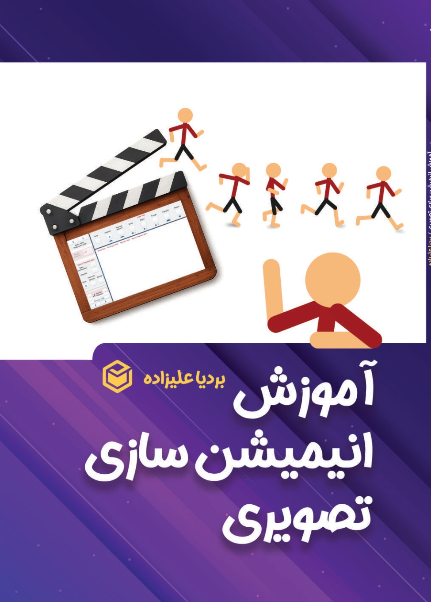
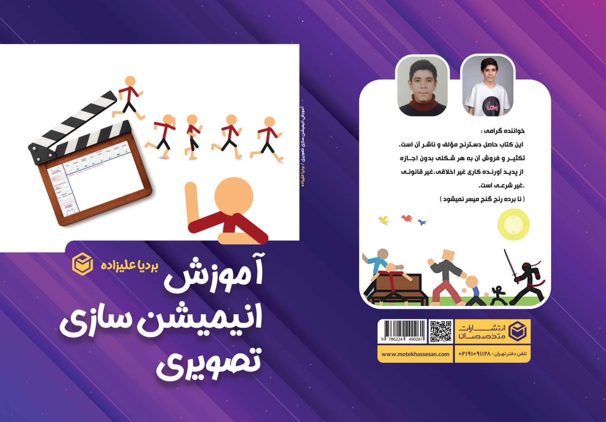
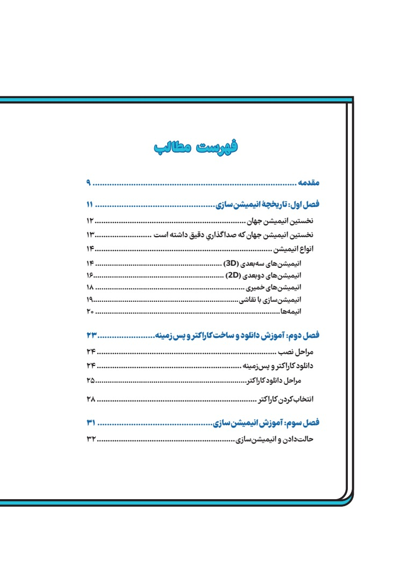
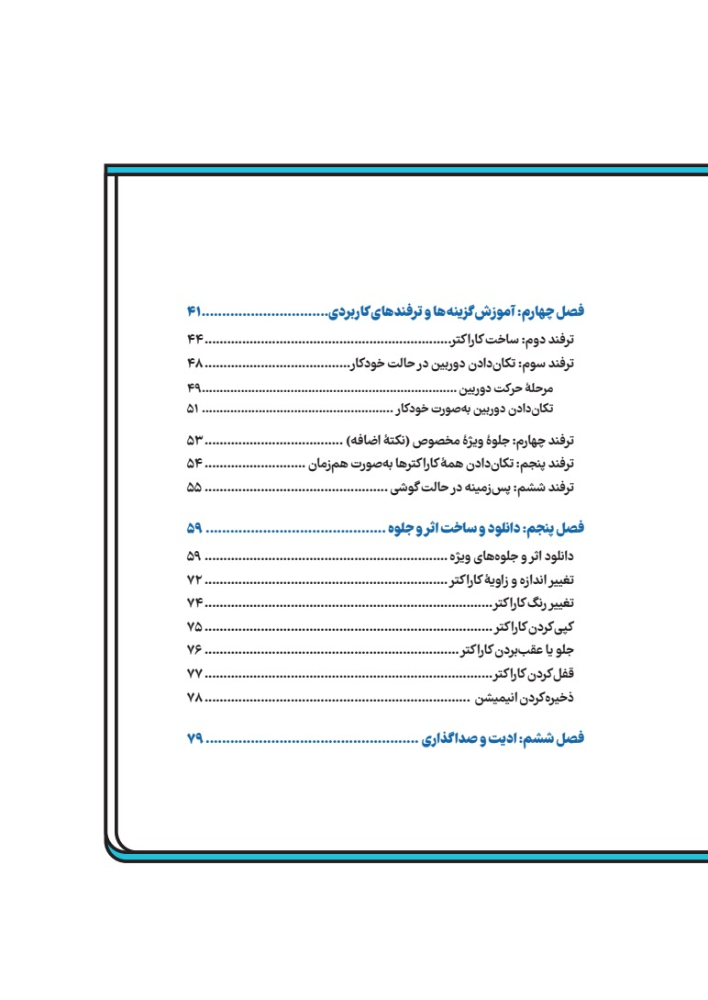
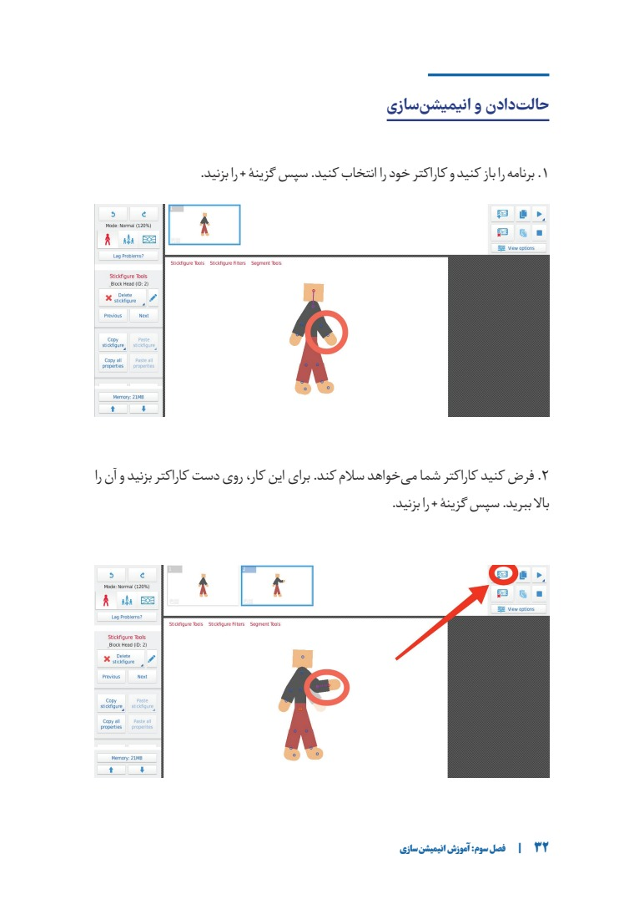

# Visual Animation Tutorial

**آموزش انیمیشن سازی تصویری · راهنمایی تصویری و تمرین‌محور برای شروع ساخت انیمیشن.**

[English](https://github.com/FarlandGame/Visual-Animation-Tutorial/blob/main/README.md) · [日本語](https://github.com/FarlandGame/Visual-Animation-Tutorial/blob/main/docs/README.ja.md) · [فارسی](https://github.com/FarlandGame/Visual-Animation-Tutorial/blob/main/docs/README.fa.md) · [Deutsch](https://github.com/FarlandGame/Visual-Animation-Tutorial/blob/main/docs/README.de.md) · [Français](https://github.com/FarlandGame/Visual-Animation-Tutorial/blob/main/docs/README.fr.md) · [Español](https://github.com/FarlandGame/Visual-Animation-Tutorial/blob/main/docs/README.es.md) · [Português (Brasil)](https://github.com/FarlandGame/Visual-Animation-Tutorial/blob/main/docs/README.pt-BR.md) · [Italiano](https://github.com/FarlandGame/Visual-Animation-Tutorial/blob/main/docs/README.it.md) · [Nederlands](https://github.com/FarlandGame/Visual-Animation-Tutorial/blob/main/docs/README.nl.md) · [Polski](https://github.com/FarlandGame/Visual-Animation-Tutorial/blob/main/docs/README.pl.md) · [Українська](https://github.com/FarlandGame/Visual-Animation-Tutorial/blob/main/docs/README.uk.md) · [Türkçe](https://github.com/FarlandGame/Visual-Animation-Tutorial/blob/main/docs/README.tr.md) · [Русский](https://github.com/FarlandGame/Visual-Animation-Tutorial/blob/main/docs/README.ru.md) · [简体中文](https://github.com/FarlandGame/Visual-Animation-Tutorial/blob/main/docs/README.zh-CN.md) · [繁體中文](https://github.com/FarlandGame/Visual-Animation-Tutorial/blob/main/docs/README.zh-TW.md) · [한국어](https://github.com/FarlandGame/Visual-Animation-Tutorial/blob/main/docs/README.ko.md) · [हिन्दी](https://github.com/FarlandGame/Visual-Animation-Tutorial/blob/main/docs/README.hi.md) · [Bahasa Indonesia](https://github.com/FarlandGame/Visual-Animation-Tutorial/blob/main/docs/README.id.md)

<!-- PLAYFUL_INTRO_START -->

> حتی یک آدمک خطی هم حق دارد با شکوه وارد صحنه شود! امروز اولین ژست، قدم بعدی صحنهٔ کوچک خودت. 📚🎬

[آشنایی با کبیر: داستان من، شروع کار و برنامه‌هایم برای ژاپن](https://github.com/FarlandGame/FarlandGame/blob/main/docs/story.fa.md)
<!-- PLAYFUL_INTRO_END -->

**علاقه به ساخت انیمیشن را به اولین صحنه‌ای تبدیل کنید که خودتان می‌سازید.** این کتاب ابتدا شما را با دنیای انیمیشن آشنا می‌کند و سپس با آموزش‌های تصویری وارد کار عملی می‌شود: آماده‌کردن کاراکتر، ساخت حالت‌ها، بهترکردن حرکت، جابه‌جایی دوربین، استفادهٔ دوباره از جلوه‌ها و در پایان ادیت و صداگذاری. آموزش‌های عملی اصلی با **Stick Nodes** انجام می‌شوند و بر شروع کار با گوشی تمرکز دارند.

## نویسندگان و پدیدآورندگان

- **بردیا علیزاده، ملقب به کبیر · Farland_game** — Bardiya Alizadeh (Kabir). [رزومهٔ گیت‌هاب](https://github.com/FarlandGame) · [کانال انیمیشن](https://www.youtube.com/@Farland_animation).
- **ارمیا علیزاده، ملقب به کبیر · ArmiyaFbix** — Armiya Alizadeh (Kabir)، برادر دوقلوی بردیا. [کانال یوتیوب](https://www.youtube.com/@ArmiyaFabix).

در این رزومه، پروژهٔ کتاب و نسخهٔ انگلیسی مشترک آن با نام هر دو برادر معرفی می‌شود. جلد چاپ‌شدهٔ فارسی و فهرست فعلی فروشگاه‌ها نام بردیا علیزاده را دارند؛ در اینجا سهم ارمیا نیز به درخواست پدیدآورندگان معرفی شده است. نام هنری او **ArmiyaFbix** است و کانال پیوندشده فعلاً شناسهٔ **ArmiyaFabix** را دارد.

## مسیری صمیمی از علاقه تا ساختن

وقتی فقط فیلم نهایی را می‌بینیم، انیمیشن‌سازی ممکن است دور از دسترس به نظر برسد. نقطهٔ قوت این راهنما، روشن‌کردن قدم کوچک بعدی است. تصویر محیط برنامه، علامت‌گذاری ابزارها و توضیح‌های کوتاه، ایده‌ای مثل سلام‌کردن یک کاراکتر را به حالت‌ها و فریم‌های لازم برای اجرای آن پیوند می‌دهند. لحن صمیمی و تشویق‌کنندهٔ کتاب، خواننده را به امتحان‌کردن، تماشای نتیجه و بهترکردن آن دعوت می‌کند.

فصل آغازین، آشنایی کوتاهی با تاریخچه و سبک‌های انیمیشن، از جمله دوبعدی، سه‌بعدی، خمیری و استاپ‌موشن، نقاشی و انیمه ارائه می‌کند. بخش عملی اصلی سپس روی **ساخت انیمیشن دوبعدی با آدمک‌ها** متمرکز می‌شود. این تمرکز، نقطهٔ شروع مشخصی به تازه‌کار می‌دهد و در عین حال جایگاه مهارت‌های تازه را در دنیای گسترده‌تر انیمیشن نشان می‌دهد.

## در کتاب چه چیزهایی را تجربه می‌کنید؟

1. **تاریخچه و سبک‌ها:** پیش از انتخاب اثری که می‌خواهید بسازید، با شیوه‌های مختلف انیمیشن آشنا می‌شوید.
2. **کاراکتر و پس‌زمینه:** نصب برنامه، پیداکردن و واردکردن فایل‌ها، انتخاب کاراکتر و آماده‌کردن صحنه.
3. **حالت و حرکت:** ساخت انیمیشن سلام‌کردن، آزمودن فاصله و زمان‌بندی فریم‌ها و استفاده از میان‌یابی یا Tweening برای پیوند نرم‌تر حالت‌ها.
4. **ابزارهای خلاقانه:** واردکردن عکس دلخواه، ساخت کاراکتر با شکل‌های ساده، تنظیم دوربین، حرکت هم‌زمان چند کاراکتر و تغییر قاب صحنه.
5. **جلوه‌ها و مدیریت صحنه:** واردکردن جلوه، ساخت عناصر متحرک قابل استفادهٔ مجدد، تغییر اندازه، زاویه و رنگ، کپی کاراکتر، تنظیم جلو و عقب بودن، قفل‌کردن و ضبط نتیجه.
6. **ادیت و صداگذاری:** آشنایی کوتاه در فصل پایانی با واردکردن انیمیشن به ویرایشگر و افزودن موسیقی یا صدا.

## چرا این کتاب بخش ارزشمندی از رزومه است؟

- **آموزش تصویری با هدف روشن.** تصویرها بخشی از خود درس‌اند: ابزار یا مفصل مورد نظر را نشان می‌دهند تا خواننده توضیح نوشته‌شده را در محیط برنامه پیدا کند.
- **تمرین‌های کوچک با فرصت خیال‌پردازی.** سلام‌کردن یک کاراکتر، نتیجهٔ اولیه‌ای قابل‌دستیابی است؛ تمرین‌های بعدی از خواننده می‌خواهند چند کاراکتر و حرکت را در صحنه‌ای کوچک ترکیب کند.
- **راهی فراتر از فایل‌های آماده.** عکس‌های شخصی، ساخت شکل‌های ساده و جلوه‌های قابل استفادهٔ دوباره به خواننده کمک می‌کنند صحنه را مطابق ایدهٔ خودش بسازد.
- **توجه به صحنهٔ کامل.** حرکت دوربین، قاب‌بندی، حرکت هم‌زمان، ترتیب قرارگیری عناصر و صدا، نگاه خواننده را از حرکت یک آدمک به شیوهٔ ارائهٔ یک سکانس گسترش می‌دهند.
- **نقطهٔ شروعی در دسترس.** تمرکز بخش عملی بر گوشی، برای کسانی مفید است که می‌خواهند با وسیله‌ای که همین حالا در اختیار دارند شروع کنند.

این پروژه برای بردیا و ارمیا، انیمیشن، آموزش و نشر را نیز کنار هم می‌آورد: تبدیل تجربهٔ خلاقانه به یک منبع یادگیری تصویری که دیگران بتوانند آن را دنبال کنند.

## این کتاب برای چه کسانی است؟

تازه‌کارهای علاقه‌مند، دانش‌آموزان، هنرجویان انیمیشن و تولیدکنندگان محتوایی که می‌خواهند نخستین صحنه‌های کوتاه دوبعدی خود را بسازند. برای کسانی که با دیدن مثال و انجام‌دادن بهتر یاد می‌گیرند، شروع مناسبی است. متن نسخهٔ فارسی به فارسی است؛ صفحه‌های چندزبانهٔ این مخزن، معرفی کتاب هستند و جای ترجمهٔ کامل کتاب را نمی‌گیرند.

## نگاهی به نسخهٔ فارسی

جلد بنفش اصلی، نمای کامل رو و پشت جلد، دو صفحهٔ فهرست و یک صفحهٔ نمونهٔ درس در اینجا نمایش داده شده‌اند. این تصویرها پیش‌نمایش‌اند؛ فایل PDF کامل تجاری کتاب در این مخزن توزیع نمی‌شود.

 

## نسخه‌ها و راه‌های تهیهٔ کتاب

| نسخه | محل مراجعه | وضعیت |
|---|---|---|
| نسخهٔ چاپی فارسی | [نشر متخصصان](https://shop.motekhassesan.com/product/آموزش-انیمیشن-سازی-تصویری/) · [دیجی‌کالا](https://www.digikala.com/product/dkp-20238095/) | صفحهٔ کالا تأیید شده؛ موجودی و ارسال را در فروشگاه بررسی کنید |
| نسخهٔ دیجیتال فارسی | [طاقچه](https://taaghche.com/book/235981/آموزش-انیمیشن-سازی-تصویری) | صفحهٔ کتاب الکترونیکی با فرمت PDF تأیید شده است |
| نسخهٔ انگلیسی · جلد زرد | انتشار در آمازون در برنامه است | در دست انتشار؛ لینک مستقیم خرید پس از انتشار اضافه می‌شود |

پدیدآورندگان در حال آماده‌سازی نسخهٔ انگلیسی با عنوان ترجمه‌شدهٔ **Visual Animation Tutorial** و نام هر دو برادر، بردیا و ارمیا، هستند. جلد زرد برای آن در نظر گرفته شده است. انتشار و صفحهٔ محصول در آمازون هنوز تأیید نشده؛ پس از عرضه، این صفحه به‌روزرسانی می‌شود. پیش‌نمایش‌های بالا متعلق به **نسخهٔ فارسی** هستند.

## مشخصات نسخهٔ فارسی

| مشخصه | اطلاعات |
|---|---|
| عنوان اصلی | آموزش انیمیشن سازی تصویری |
| عنوان انگلیسی | Visual Animation Tutorial |
| نویسندهٔ درج‌شده در نسخهٔ فارسی | Bardiya Alizadeh / بردیا علیزاده |
| نام‌های پروژهٔ کتاب و نسخهٔ انگلیسی | Bardiya Alizadeh (Kabir) · Farland_game؛ Armiya Alizadeh (Kabir) · ArmiyaFbix |
| ناشر | Motekhassesan Publishing / نشر متخصصان |
| ویراستار | Sahar Ghorbani / سحر قربانی |
| زبان نسخهٔ منتشرشده | فارسی |
| تعداد صفحه | 77 صفحه |
| شابک | 978-622-449-026-1 |

## منابع و اعتبار تصویرها

معرفی فصل‌ها و مثال‌های آموزشی با PDF چاپ اولِ ارائه‌شده از سوی پدیدآورندگان بررسی شده‌اند. تصویرهای جلد از PDF جلد فارسی آن‌ها تهیه شده و فهرست و نمونهٔ درس نیز از PDF متن کتاب آمده‌اند. اعتبارهای اصلی تصویر و نشر در تصویرها حفظ شده‌اند. حقوق کتاب و جلد برای صاحبان مربوط محفوظ است.

صفحه‌های مرجع: [ناشر](https://shop.motekhassesan.com/product/آموزش-انیمیشن-سازی-تصویری/)، [دیجی‌کالا](https://www.digikala.com/product/dkp-20238095/)، [طاقچه](https://taaghche.com/book/235981/آموزش-انیمیشن-سازی-تصویری). لینک‌ها و اطلاعات نسخه‌ها در **26 اکتبر 2026** بررسی شده‌اند. قیمت، موجودی و ارسال را فروشگاه‌ها تعیین می‌کنند. اطلاعات جلدِ در نظر گرفته‌شده و نام‌های مشترک نسخهٔ انگلیسی را پدیدآورندگان ارائه کرده‌اند.

[رزومهٔ کامل آثار خلاقانه و پروژه‌های نرم‌افزاری بردیا](https://github.com/FarlandGame)
