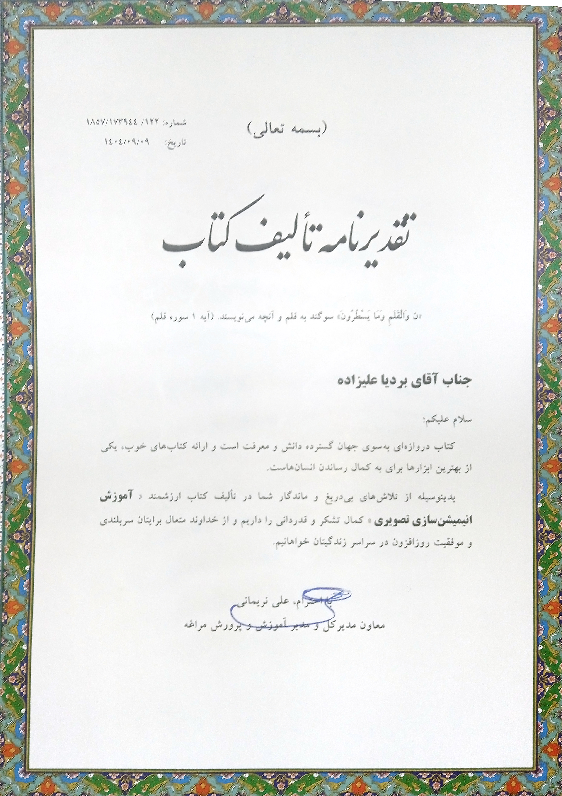

# Благодарность за написание книги

<!-- DOCUMENT_PAIR_BOOK_START -->
<table>
<tr><th>Исходный документ · копия для просмотра</th><th>Неофициальный русский перевод</th></tr>
<tr><td valign="top"></td><td valign="top"></td></tr>
</table>
<!-- DOCUMENT_PAIR_BOOK_END -->
[English](https://github.com/FarlandGame/Visual-Animation-Tutorial/blob/main/docs/recognition.en.md) · [فارسی](https://github.com/FarlandGame/Visual-Animation-Tutorial/blob/main/docs/recognition.fa.md) · [日本語](https://github.com/FarlandGame/Visual-Animation-Tutorial/blob/main/docs/recognition.ja.md) · [Русский](https://github.com/FarlandGame/Visual-Animation-Tutorial/blob/main/docs/recognition.ru.md)

Управление образования Мараге вручило Бардии Ализаде благодарственную грамоту за книгу **Visual Animation Tutorial**. На документе стоит дата 1404/09/09 по солнечной хиджре. Это местная благодарность за авторскую работу; общенациональная премия или квалификация не заявлены.

## Неофициальный русский перевод

## Текст перевода
**Благодарственная грамота · За написание книги**

Во имя Всевышнего

«Нун. Клянусь пером и тем, что они пишут».
Коран, сура «Письменная трость», аят 1

Уважаемый господин Бардия Ализаде!
Мир вам.

Книга — врата в обширный мир знаний и понимания. Предоставлять людям хорошие книги — один из лучших способов помогать им раскрыть свой потенциал.

Настоящим выражаем искреннюю благодарность и признательность за ваши неустанные и значимые усилия по написанию ценной книги Visual Animation Tutorial (آموزش انیمیشن سازی تصویری). Просим Всемогущего даровать вам почёт и возрастающие успехи на протяжении всей жизни.

Али Наримани
Заместитель генерального директора и руководитель управления образования Мараге

Дата: 1404/09/09 (солнечная хиджра)
Регистрационный номер: см. исходную фотографию; неясные цифры не восстановлены.

## Исходный документ

Фотография-источник сохранена без изменений. Копия для просмотра исправляет перспективу, освещение и кадр; это не цифровой перевыпуск документа. В переводе не восстановлены подпись, печать или неясный регистрационный номер.

[Исходная фотография](https://raw.githubusercontent.com/FarlandGame/Visual-Animation-Tutorial/main/assets/recognition/certificate-original.jpg) · [Книга](https://github.com/FarlandGame/Visual-Animation-Tutorial/blob/main/docs/README.ru.md)
